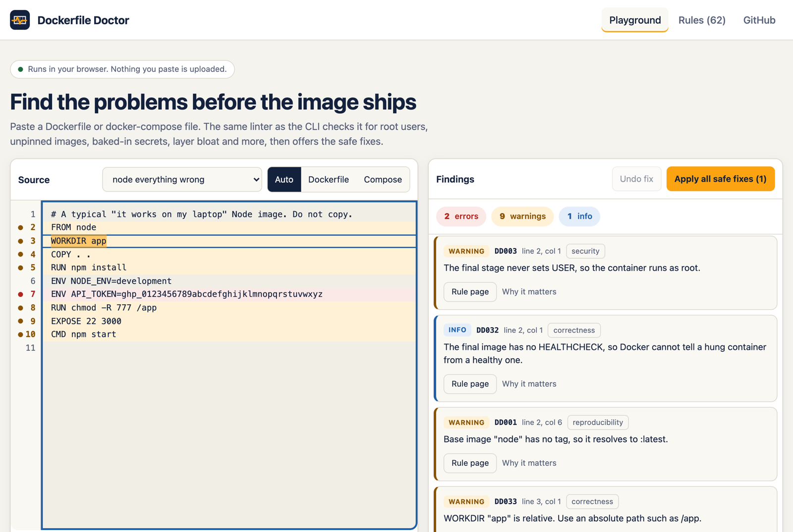
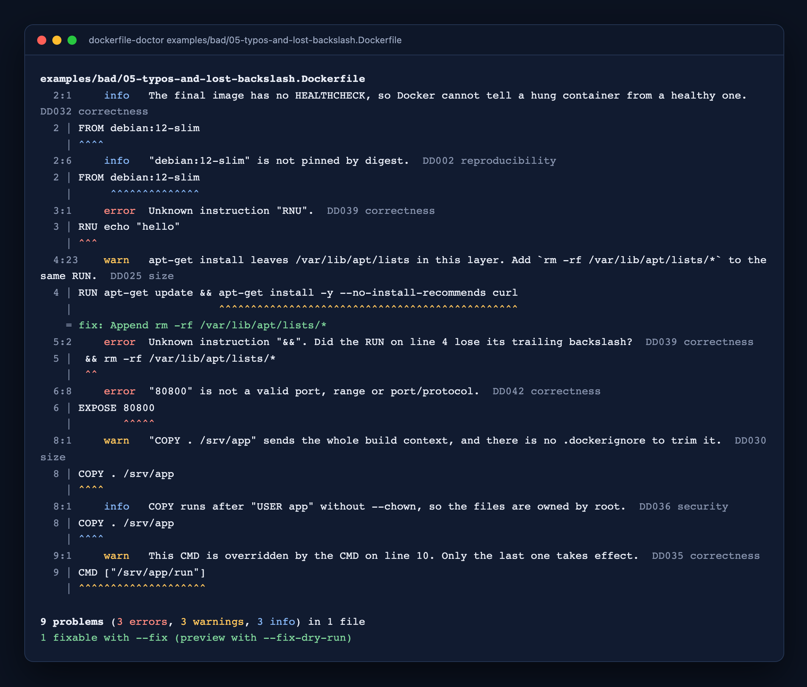
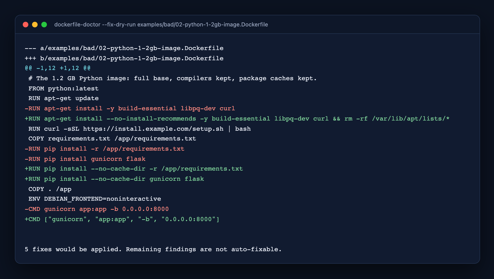
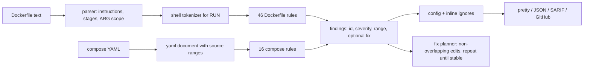

# Dockerfile Doctor

**A fast, dependency-light linter and fixer for Dockerfiles and docker-compose files. It looks for the things small teams ship by accident: root users, `latest` tags, secrets baked into `ENV`, 1 GB images, no healthchecks.**

[](https://github.com/Victor-Wambua/dockerfile-doctor/actions/workflows/ci.yml)
[](LICENSE)

-brightgreen)

**[Live playground and rule catalogue](https://victor-wambua.github.io/dockerfile-doctor/)** (the linter running in your browser)



> **Status:** portfolio build. Runs locally and in CI with sample data. Not published to npm. It reads files only: it does not scan images or look up CVEs.

## The problem

Most small teams have no one who reviews Dockerfiles. So they ship containers that run as root, pull `node:latest`, copy `.env` into a layer, and weigh 1.2 GB because a compiler and the apt cache came along. Nothing fails. It just costs money, build minutes and, once in a while, an incident.

Existing linters exist, but they either need Docker, stop at the Dockerfile, or are hard to wire into a pull request. Dockerfile Doctor works on plain files, covers compose too, explains every finding in plain language, and fixes the safe ones for you.

## What it does

- **62 rules with stable ids** (46 for Dockerfiles `DD001`-`DD046`, 16 for compose files `DC000`-`DC015`). Each has a severity (error/warn/info), a category (security, reproducibility, size, correctness, maintainability), an explanation, a "why it matters" and a before/after example. [Browse them](https://victor-wambua.github.io/dockerfile-doctor/rules.html) or read [docs/RULES.md](docs/RULES.md). Both are generated from the rule metadata, so they cannot drift.
- **A real parser**, not regexes over lines: continuations, comments inside continuations, parser directives (`# escape=`), heredocs, multi-stage `FROM ... AS`, `ARG`/`ENV` scoping, JSON vs shell form. RUN scripts are tokenised so `apt-get install` or `curl | sh` is found even in a five-line `&&` chain.
- **Output for people and for machines:** coloured terminal report with source excerpts and carets, JSON, **SARIF 2.1.0** (for GitHub code scanning) and GitHub Actions annotations.
- **`--fix` for the safe subset** (11 rules), with `--fix-dry-run` to see a diff first. Fixes are applied until nothing more can be fixed, and a second run changes nothing.
- **Config and ignores:** `.dockerdoctor.yml` (disable rules, change severity, per-path ignores, excludes) and inline `# dd-ignore DD003 -- reason` comments.
- **Exit codes by severity threshold**, so it can gate CI at whatever level you choose.
- **A composite GitHub Action** (`action.yml`) that annotates pull requests and can upload SARIF.
- **Good and bad examples.** `examples/good/` has Laravel (php-fpm + nginx), FastAPI (uv) and Node (distroless) images that lint with zero errors and zero warnings and are built and run on every CI run. `examples/bad/` is a gallery of broken files used in the docs and tests.





## Quick start

Needs Node 22 or 24 (what CI runs; the `engines` field allows 20 and up, but that is untested).

```bash
git clone https://github.com/Victor-Wambua/dockerfile-doctor.git
cd dockerfile-doctor
npm ci
npm run build

# Lint the bad gallery. --no-config is needed because this repo's own config ignores examples/bad.
node dist/cli.js --no-config examples/bad

# The good examples are clean (info-level notes only):
node dist/cli.js examples/good

# Preview the automatic fixes, then apply them to a copy of a bad file:
node dist/cli.js --no-config --fix-dry-run examples/bad/02-python-1-2gb-image.Dockerfile
```

Run it on your own project:

```bash
node dist/cli.js path/to/project            # finds Dockerfile, Dockerfile.*, *.Dockerfile, compose*.yml
node dist/cli.js -f sarif -o results.sarif path/to/project
node dist/cli.js --explain DD007            # the full explanation for one rule
node dist/cli.js --list-rules
```

Try it without installing anything: open the [playground](https://victor-wambua.github.io/dockerfile-doctor/).

### Command line

| Option | Meaning |
| --- | --- |
| `-f, --format` | `pretty` (default), `json`, `sarif`, `github` |
| `--fail-on` | `error`, `warn` (default), `info`, `never`. Exit code 1 when a finding is at or above it |
| `--fix` / `--fix-dry-run` | Apply the safe fixes in place / print a diff and write nothing |
| `-c, --config` / `--no-config` | Use a specific config file / ignore config files |
| `--disable DD002,DD032` | Turn rules off for this run |
| `--rule DD001=error` | Set one rule to `off`, `error`, `warn` or `info` (repeatable) |
| `--stdin [--type compose]` | Read from stdin; `--stdin-filename` names it |
| `-o, --output FILE` | Write the report to a file |

Exit codes: `0` clean at the threshold, `1` findings at or above it, `2` usage or config error.

### GitHub Action

```yaml
name: Dockerfile Doctor
on: [pull_request]
permissions:
  contents: read
  security-events: write     # only needed for upload-sarif
jobs:
  lint:
    runs-on: ubuntu-latest
    steps:
      - uses: actions/checkout@v4
      - uses: Victor-Wambua/dockerfile-doctor@main
        with:
          path: .
          fail-on: warn
          upload-sarif: "true"
```

Findings appear as annotations on the pull request, a readable report goes to the job summary, and the SARIF upload feeds the Security tab. This repo's own CI runs the action against `examples/good` (must pass) and `examples/bad` (must fail). Using it from a different repository is the same mechanism but has not been exercised outside this repo.

## Configuration

`.dockerdoctor.yml`, found by walking up from the current directory:

```yaml
rules:
  DD002: off          # don't ask for digest pins
  DD032: warn         # make "no HEALTHCHECK" a warning
  DD036: error
exclude:
  - vendor/**         # never scanned
ignore:               # scanned, but these rules are dropped for matching paths
  - path: legacy/**
    rules: [DD003, DD019]
  - path: examples/bad/**
    rules: [all]
failOn: warn
```

Precedence, lowest to highest: rule defaults, then the config file, then command-line flags (`--disable`, `--rule`). Inline ignores and per-path ignores remove findings after that. Unknown rule ids or keys are an error (exit 2), so a typo cannot silently disable nothing.

Inline ignores:

```dockerfile
# dd-ignore DD003 -- the platform injects a non-root user at runtime
FROM registry.example.com/base:1.4
```

```yaml
services:
  db:
    # dd-ignore DC005
    ports: ["5432:5432"]
```

A Dockerfile comment applies to the next instruction (all its lines). A YAML comment on its own line applies to the next line and everything nested under it; after code, to that line. `# dd-ignore-file DD019` applies to the whole file.

## How it works



The core (`src/core`, `src/rules`) has no Node-specific imports, so the same code runs in the CLI and, bundled with esbuild, in the browser playground. Everything is expressed as character ranges into the original text, which is what makes carets, SARIF regions and `--fix` edits line up exactly, even across continuation lines. Key decisions are written up in [docs/CASE-STUDY.md](docs/CASE-STUDY.md).

## Testing

```bash
npm test          # 576 tests, offline, about a second
npm run ci        # lint + typecheck + tests + build + docs check + lint the good examples
```

Real numbers from the last run: **576 tests in 11 files, all passing**; Biome lint and `tsc --strict` clean. What they cover:

- **Every rule has at least one failing and one passing fixture** in `tests/fixtures/rules/<ID>/` (199 fixture files). A test fails if a rule is added without both, so the catalogue cannot go untested.
- **Parser edge cases:** continuations, comments mid-continuation, CRLF, escape directive, heredocs (including `<<-`, quoted and unterminated), multi-stage, ARG scoping, JSON vs shell form.
- **`--fix`:** golden rewrites, cases that must be left alone, and an idempotency test over all 199 fixtures (fix, re-lint, nothing fixable remains, second fix is a no-op).
- **SARIF:** every fixture's output is validated against the **official OASIS SARIF 2.1.0 schema** (vendored in `tests/vendor`), plus a check that the validator rejects broken documents.
- **Config precedence, inline ignores, per-path ignores,** CLI exit codes and discovery (temp directories).
- **Robustness:** the linter is run on prefixes of every fixture and on hostile input and must not throw.
- **Examples:** each good example has zero errors and warnings, and each bad example triggers exactly the rule ids it declares in its `# expect:` header.
- **CI builds the good examples with Docker** on `ubuntu-latest`, runs them, and waits for their `HEALTHCHECK` to report healthy. Not covered: coverage percentages (not measured).

## Project layout

```
src/core/        parser, shell tokenizer, engine, config, ignores, secrets, fix planner, diff
src/rules/       dockerfile/ (46 rules in 4 files) and compose/ (16 rules)
src/reporters/   pretty, json, sarif, github
src/node/        file discovery, config loading, CLI runner
docs/web/        playground and catalogue sources (esbuild bundles src/core for the browser)
docs/            CASE-STUDY.md, RULES.md (generated), screenshots/
examples/good/   laravel, fastapi, node (+ sample app files so they build)
examples/bad/    gallery of broken Dockerfiles and a compose file
tests/           vitest suites and fixtures
action.yml       composite GitHub Action
```

## Status and roadmap

Works today: everything above, with sample and fixture data only. The three good examples build and run in CI (images on the CI runner: Node distroless 204 MB, FastAPI 208 MB, Laravel-shaped php-fpm 125 MB and nginx 74 MB, as reported by `docker image ls`).

Known limitations:

- Files only. It never looks inside an image, queries a registry, or checks for CVEs. Use a scanner for that.
- Secret detection is heuristic (name patterns, known token formats, entropy). It will miss some secrets and occasionally flag a harmless value; use `# dd-ignore`.
- The shell analysis is a tokenizer, not a shell: it does not follow variables, functions or `eval`.
- "Runtime image" rules look at the **last** stage (and the stages it is built on). A multi-target file with several deliverable stages is only checked for the last one.
- Compose: `extends`, `include` and variable interpolation are not followed; only the file you point at is read.
- No comparison with other linters has been made, so there are no accuracy or speed claims beyond the tests above.

Next steps: publish to npm, a `--baseline` file so existing projects can adopt it without fixing everything at once, Kubernetes manifest rules, per-stage `--target` awareness, and autofix for `COPY --chown`.

---

Built by Victor Wambua · [portfolio](https://victor-wambua.github.io/victor-portfolio/) · [case studies](https://github.com/Victor-Wambua/case-studies)

MIT licensed, see [LICENSE](LICENSE).
