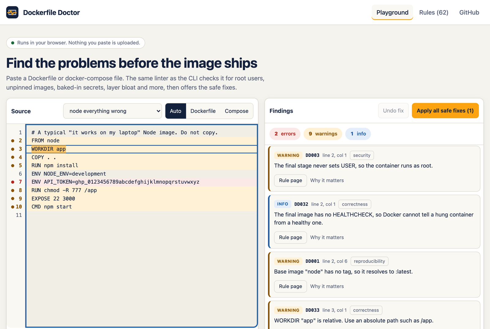

# Case study: Dockerfile Doctor

## The problem

Small teams ship containers without anyone reviewing the Dockerfile. I see the same handful of things in client and charity projects, and I have written most of them myself: no `USER`, so the app runs as root; `FROM node` with no tag; a database password in `ENV`; `COPY . .` before `npm install`, so every build re-downloads the world; a compose file that publishes Postgres on `0.0.0.0:5432` and mounts `docker.sock`. Nothing fails. The image just gets bigger, builds get slower, and the risk sits there until it matters.

Today people cope by copying a Dockerfile from the last project, or by running a scanner late in the pipeline. Scanners look at what is inside the built image. They do not tell you that the cause is a missing `--no-install-recommends` on line 6.

## Goals and non-goals

Goals: work on plain files (my machine has no Docker, and a lot of CI should not need it); explain every finding in plain language; produce SARIF so findings show in the GitHub Security tab; fix the safe cases automatically; run the identical code in a browser playground; keep one runtime dependency.

Non-goals: scanning images, looking up CVEs, replacing Hadolint's long tail of rules, or policy-as-code. This is a reviewer for the file in front of you.

## What I built

A TypeScript CLI, library and GitHub Action with 62 rules (46 Dockerfile, 16 compose), four output formats, `--fix`, a config file, inline ignores and a static playground. Three example apps (Laravel, FastAPI, Node) are written to lint clean and are built and run on CI.

## Design decisions and trade-offs

**1. Parse properly, and track offsets, not lines.** The first version of this idea is a regex per rule. It breaks on the first multi-line `RUN`. I wrote a parser that joins continuations into one logical instruction, drops comment lines inside a continuation, handles `# escape=` and heredocs, and keeps an array that maps every character of the logical text back to its offset in the file. Rules report ranges in the logical text; the engine converts them to file positions. That one choice paid for three features: carets in the terminal, SARIF regions, and `--fix` edits that insert `--no-install-recommends` in the middle of a five-line `RUN` without touching its neighbours. The alternative, rewriting whole lines, would have reformatted people's files.

**2. Tokenise RUN, do not interpret it.** I considered a full shell parser and dropped it: the Dockerfile cases I care about need only "which commands run, in what order, joined by what, with which words". The tokenizer understands quotes, `$(...)`, comments, operators and pipes, and skips `sudo`, `env VAR=x` and similar wrappers. It deliberately does not follow variables or functions. That is a limit (see below), but it keeps the rules short and predictable.

**3. False positives are the product.** A linter people disable on day two is worthless, so most of the design effort went into restraint:
- *Severity follows consequence.* `curl | sh` and a literal `ENV DB_PASSWORD` are errors. Missing `HEALTHCHECK` is info, because Kubernetes ignores it and batch images legitimately have none. Missing `--chown` is info, because root-owned read-only code is often better.
- *Scope follows what ships.* Size rules (`apt` hygiene, `pip` cache, compilers, dev dependencies) apply to the final stage and the stages it is built on, not to a throwaway builder. Reporting `build-essential` in a build stage would be wrong and noisy.
- *Look for the real bug, not the smell.* `ARG` scope is checked by comparing what is declared before `FROM` with what is used inside the stage, because the failure (an empty variable) is silent. `COPY --from=nginx` is not flagged, since a bare name may be an image; only a name one typo away from a real stage is.
- *Known-safe shapes are exempt.* `:nonroot` distroless and `*-unprivileged` bases skip the root check. A pipeline of `echo ... | sha256sum` skips the `pipefail` rule because `echo` cannot fail meaningfully. An `apk add --virtual` that is deleted in the same `RUN` is not a compiler leak.
- *Secrets: names are a hint, values decide.* A secret-like name with a literal value is flagged; `TOKEN_FILE`, `PASSWORD_MIN_LENGTH` and `${VAR}` references are not. Entropy only counts for long token-shaped strings, and hex strings of checksum length are excluded because `NODE_SHA256=...` style values are everywhere in real Dockerfiles (a fixture pins this).
- *The escape hatch is cheap.* `# dd-ignore DD003 -- reason` sits next to the thing it excuses, and per-path ignores cover legacy directories.
- *Compose splits the secret rule by severity.* A known credential format is an error; a literal `POSTGRES_PASSWORD` is a warning, because compose files are often local-only.

**4. Fixes must be boring.** A fixer that can break a build gets turned off. Only 11 rules rewrite, and only when the change cannot alter meaning: adding flags, `ADD`→`COPY` when there is no URL or archive, `MAINTAINER`→`LABEL`, shell-form `CMD` to exec form only when it has no variables, pipes, globs or builtins. Fixes are plain edits; the planner accepts non-overlapping ones, defers the rest to the next pass, and repeats until stable. Two inserts at the same offset (`-y` and `--no-install-recommends`) keep a deterministic order. A test runs this over every fixture and asserts that re-linting leaves nothing fixable and a second run is a no-op.

**5. SARIF, and why not only JSON.** GitHub code scanning takes SARIF, and it gives results that stay on the pull request, de-duplicated across runs by fingerprint, with rule help text and a `security-severity` that sorts them in the Security tab. JSON would have been simpler, so I kept both: JSON for scripts, SARIF for GitHub. I vendored the official 2.1.0 schema and validate real output against it in tests. One snag: that schema is JSON Schema draft-04, which current Ajv no longer ships, so the test uses `ajv-draft-04`.

**6. One core, two hosts.** The core has no Node imports. The CLI adds file discovery, config loading and exit codes. The playground bundles the same core with esbuild. The only runtime dependency is `yaml`, because I did not want to write a YAML parser, and its ranges are what let compose findings point at the exact key.

## How it is kept correct and safe

- A test fails if any rule lacks a failing and a passing fixture, so adding a rule forces its tests.
- Prefix fuzzing: every fixture is linted at about 25 truncation points, plus hostile inputs. It found a real bug: an unterminated quote made the tokenizer return a word end one past the text, which turned a range into `NaN`. Another test failure caught compose port parsing treating `"5432:5432"` as `ip:port`, which hid the database-port rule.
- The good examples are not just linted. CI builds them on a Docker runner, runs them, and waits for their healthcheck. That is the check that I wrote valid Dockerfiles rather than Dockerfiles that merely satisfy my own rules.
- The tool never executes anything from the files it reads and makes no network calls. Secret values are never echoed in messages; findings name the kind of credential, not its content.

## What I'd do differently, and what's next

I would have kept the `# expect:` header idea from the start for every rule's fixtures; I added it late for the bad gallery. A `--baseline` file is the most useful missing feature, because it lets a team adopt the tool on an old repository without fixing 200 findings first. Per-target awareness would remove the "last stage only" limit. Publishing to npm and Kubernetes manifest rules come after that.

Honest limits: it reads files, so it cannot see what a base image contains or whether a package has a CVE. Secret detection is heuristic and will miss things. The shell analysis does not follow variables, so `RUN $INSTALL` is opaque. Compose `extends`/`include` are not followed. I have not benchmarked it against other linters, so I make no accuracy claims.

## Status

Portfolio build. All sample data is synthetic; there are no real credentials in the repository (the AWS and GitHub tokens in `examples/bad` are the documented example values and made-up strings). 576 tests pass offline; CI also builds and runs the three example images. The playground is a static page on GitHub Pages. Nothing is mocked, but nothing has been used on someone else's production repository either.
